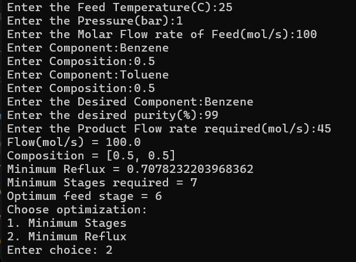
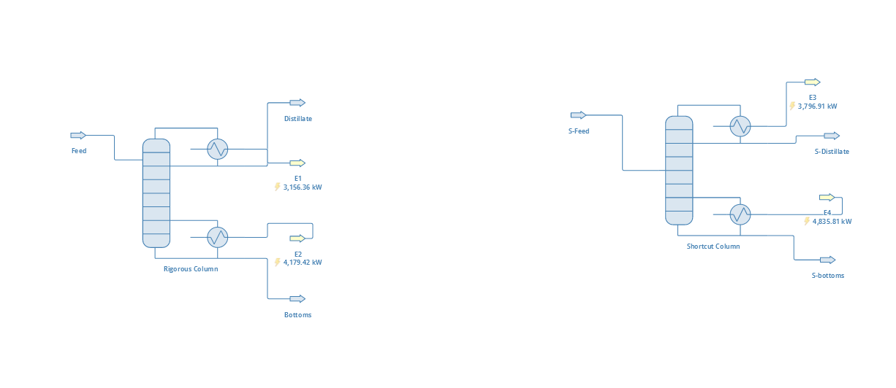
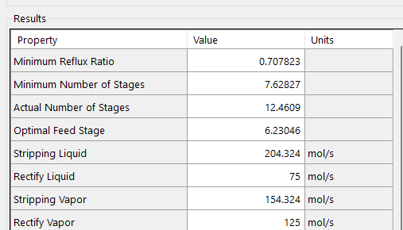
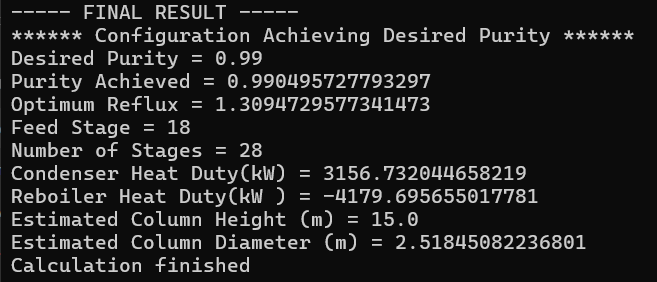

# Distillation-Column-Design-Assistant
Python Based Distillation Column Design and Optimization Using DWSIM Automation

## Overview

The Distillation Column Design Assistant combines shortcut distillation calculations with rigorous column simulation to identify feasible column configurations for a specified feed and separation target.

The tool uses Python to interact with DWSIM through its automation interface, reducing the need to manually configure and evaluate every column design.

## Features

User-defined feed temperature, pressure, molar flow rate, components, and mole fractions.

Automatic identification of light and heavy components using normal boiling points.

Shortcut-column calculations to estimate minimum reflux, minimum stages, and feed-stage location.

Rigorous distillation column simulation using DWSIM.

Two optimization modes:

  **Minimum Stages**: searches for the lowest tested stage count that meets the desired product purity.

  **Minimum Reflux**: searches for the lowest tested reflux value that produces a feasible configuration under the configured stage-search procedure.

Product purity verification against the specified target.

Reporting of the selected configuration and condenser and reboiler heat duties.

## Technologies Used

Python

DWSIM

DWSIM Automation API

Python.NET (clr)

## Thermodynamic Property Package

The simulations use the **Peng–Robinson (PR) equation of state** in DWSIM to calculate thermodynamic properties and vapour–liquid equilibrium for the distillation system.

The property package is used in the rigorous-column calculations and influences the predicted phase compositions, temperatures, and energy duties. The selected thermodynamic model should remain consistent when reproducing the example case.

**Property package:** Peng–Robinson (PR)

**Example system:** Benzene–toluene mixture.

## How It Works

The user specifies the feed conditions, component composition, desired product, purity target, and product flow rate.

The program configures the feed and identifies the relevant key components.

The shortcut column provides initial design estimates.

The rigorous column is evaluated over selected reflux ratios, stage counts, and feed-stage locations.

The program reports the lowest tested feasible configuration found by the selected search procedure.

## Optimization Approach

The program uses a discrete search over reflux ratios, stage counts, and feed-stage locations. An improvement-based stopping criterion is used in the minimum-reflux mode to reduce computational time.

The reported result depends on the configured search limits, convergence behavior, and stopping criteria. It should be interpreted as the best feasible configuration found by the implemented search, not a guarantee of a global mathematical optimum.

## Example Application

A benzene–toluene mixture can be used to demonstrate the design workflow. The example should include the feed conditions, desired product purity, selected optimization mode, and resulting column configuration.

Screenshots and numerical results will be added after the example case is documented.

## Requirements

A compatible DWSIM installation.

A compatible Python and .NET environment for the DWSIM Automation API.

A DWSIM flowsheet configured with the required material streams, shortcut column, and rigorous column.

## Screenshots
**User Input**

**DWSIM Flowsheet**

**Shortcut_Results**

**Optimization_Results**

## Limitations

Simulation performance depends on the number of feed components and the convergence behavior of the rigorous column.

The search examines discrete reflux values and is restricted by configured stage and reflux limits.

The improvement-based stopping criterion may stop the stage search before all possible stage counts have been examined.

Results require validation against suitable reference calculations or independently verified simulation cases.

## Future Improvements

Expanded validation against published distillation examples.

Improved handling of convergence failures and invalid inputs.

More efficient search strategies.

Additional reporting of energy consumption and design comparisons.

## Configuration

Before running the program:

1. Install DWSIM and configure a compatible Python/.NET environment.
2. Update the DWSIM installation path in the Python script.
3. Update the flowsheet file path to point to your local `.dwxmz` file.
4. Ensure the flowsheet contains the simulation objects expected by the script.
5. Run the Python script from the configured environment.

The program has been developed around a specific DWSIM flowsheet configuration. Additional setup may be required before it can run on another computer.
